<div align="center">
  

  <h1>Lite Gemini</h1>

  <h3>A lighter, cleaner, and more macOS-native unofficial Gemini desktop client</h3>
  
  <p>
    
     
    <a href="https://github.com/TDHSC/lite-gemini/releases">
      
    </a>
  </p>

  <p>
    <a href="./README_CN.md">简体中文</a> |
    <strong>English</strong>
  </p>
</div>

## 📸 Screenshots

<div align="center">
  
</div>

## 💡 Why Lite Gemini?

Unlike bloated Electron-based apps, Lite Gemini is built entirely with native SwiftUI. No excessive memory usage, no sluggish startup — just a silky-smooth experience that feels like a built-in macOS app.

### 🚀 Key Advantages

- **Blazing Fast** — Native 120Hz SwiftUI + Apple Liquid Glass interface backed by a lightweight hidden WebKit session bridge. No API key required — uses your existing Google web account.
- **Quick Mode Anywhere** — Summon a floating Quick Bar across any Space or fullscreen app with <kbd>Opt</kbd> + <kbd>Space</kbd>, or reopen your last Quick session with <kbd>Opt</kbd> + <kbd>Shift</kbd> + <kbd>Space</kbd>.
- **Focused Experience** — Auto-focus input, native CJK IME composition support, multi-account switching, Temporary Chat, and instant SWR local conversation cache.

## ✨ Features

### 🖥️ Deep System Integration

- **Native Liquid Glass & Classic Web Dual Mode** — Native macOS Liquid Glass UI by default, with one-shortcut switching (<kbd>Cmd</kbd> + <kbd>Shift</kbd> + <kbd>M</kbd>) to Classic Web Mode whenever you need full web features like Canvas or folder uploads.
- **Quick Mode Floating Panel** — Press <kbd>Opt</kbd> + <kbd>Space</kbd> for a compact Spotlight-style prompt bar that expands into a pinned mini-window after sending; press <kbd>Opt</kbd> + <kbd>Shift</kbd> + <kbd>Space</kbd> to jump back into your most recent Quick conversation.
- **Global Hotkey** — Toggle the main window with <kbd>Ctrl</kbd> + <kbd>&#96;</kbd> (customizable or disableable).
- **New Chat Hotkey** — Start a new conversation with <kbd>Cmd</kbd> + <kbd>Shift</kbd> + <kbd>N</kbd> (customizable or disableable).
- **Launch at Login** — Start automatically when you log in.
- **Persistent Multi-Account Session** — Sign in once with Google, switch accounts from the top-right avatar, and keep recent chats and cache isolated per account.

### ⚡ Productivity Boost

- **Always on Top** — Pin the window above all others.
- **Timeout Reset** — Automatically starts a new conversation after prolonged inactivity.
- **Auto Focus** — Input field is focused whenever the window is activated.
- **Window Animation** — Smooth fade-in/fade-out transitions when showing/hiding the window.

### 🔄 Auto Updates

- **Sparkle Integration** — Built-in automatic update checking via the Sparkle framework.
- **Update Toggle** — Option to disable automatic update checks.

### 🛠️ Advanced Customization

- **Multi-language** — Native multi-language UI that follows your system language.
- **Custom User-Agent** — Flexible browser identity configuration.
- **Clear Browsing Data** — One-click removal of cookies, cache and local storage.
- **Native Rendering** — Powered by the efficient WKWebView engine.

## 📦 Installation

### Option 1: Direct Download (Recommended)

Head to [Releases](https://github.com/TDHSC/lite-gemini/releases) and download the Universal Binary installer:

* `LiteGemini-vX.X.X.dmg` — supports both Apple Silicon and Intel Macs

> [!NOTE]
> The app is not notarized by Apple, so macOS blocks it on first launch. Open **System Settings → Privacy & Security** and click **Open Anyway**, or run:
> ```bash
> xattr -dr com.apple.quarantine "/Applications/Lite Gemini.app"
> ```

### Option 2: Build from Source

To compile from source, make sure your environment meets: **macOS 14.0+** with **Xcode 26.1+** installed (required to compile the Icon Composer app icon).

```bash
git clone https://github.com/TDHSC/lite-gemini.git
cd lite-gemini
open LiteGemini.xcodeproj
```

Select your target device in Xcode, then press `Cmd + R` to build and run.

## ⌨️ Keyboard Shortcuts

| Shortcut                                           | Action                                                  |
| -------------------------------------------------- | ------------------------------------------------------- |
| <kbd>Ctrl</kbd> + <kbd>`</kbd>                     | Toggle main window (customizable in Settings)           |
| <kbd>Opt</kbd> + <kbd>Space</kbd>                  | New Quick Chat floating bar (customizable in Settings)  |
| <kbd>Opt</kbd> + <kbd>Shift</kbd> + <kbd>Space</kbd> | Reopen recent Quick Chat (customizable in Settings)   |
| <kbd>Cmd</kbd> + <kbd>Shift</kbd> + <kbd>N</kbd>   | New chat (customizable in Settings)                     |
| <kbd>Cmd</kbd> + <kbd>Shift</kbd> + <kbd>M</kbd>   | Switch between Native Liquid Glass and Classic Web Mode |
| <kbd>Cmd</kbd> + <kbd>R</kbd>                      | Reload session                                          |
| <kbd>Cmd</kbd> + <kbd>[</kbd>                      | Go back (Classic Web Mode)                              |
| <kbd>Cmd</kbd> + <kbd>]</kbd>                      | Go forward (Classic Web Mode)                           |
| <kbd>Cmd</kbd> + <kbd>W</kbd>                      | Hide window                                             |
| <kbd>Cmd</kbd> + <kbd>,</kbd>                      | Open Settings                                           |

## ⚙️ Settings

| Option                           | Description                                         | Default                                               |
| -------------------------------- | --------------------------------------------------- | ----------------------------------------------------- |
| Background Timeout               | Start a new chat after timeout                      | 10 min                                                |
| New Chats Start as Temporary     | Start new main-window chats in Temporary Chat mode  | Off                                                   |
| Launch at Login                  | Auto-start on login                                 | Off                                                   |
| Always on Top                    | Keep window in front                                | Off                                                   |
| Window Animation                 | Fade transition on show/hide                        | On                                                    |
| Show/Hide Window                 | Toggle main window shortcut                         | <kbd>Ctrl</kbd> + <kbd>`</kbd>                        |
| New Chat                         | New chat shortcut                                   | <kbd>Cmd</kbd> + <kbd>Shift</kbd> + <kbd>N</kbd>      |
| New Quick Chat                   | Quick Mode floating bar shortcut                    | <kbd>Opt</kbd> + <kbd>Space</kbd>                     |
| Recent Quick Chat                | Reopen recent Quick Mode chat shortcut              | <kbd>Opt</kbd> + <kbd>Shift</kbd> + <kbd>Space</kbd>  |
| Language                         | UI display language                                 | System                                                |
| Use Native Interface             | Enable Native Liquid Glass UI (`⌘⇧M` switches mode) | On                                                    |
| User-Agent                       | Custom browser identity                             | Safari UA                                             |
| Clear Browsing Data              | Clear cookies, cache and local conversation store   | —                                                     |
| Auto Update Check                | Check for updates automatically                     | On                                                    |

## 🛠️ Tech Stack

* **SwiftUI** — Modern declarative UI framework
* **WKWebView** — High-performance web rendering engine
* **Carbon Events** — Low-level global hotkey registration
* **Sparkle** — Mature open-source framework for macOS app updates
* **String Catalog** — Apple's recommended localization solution

## 🙏 Acknowledgements

Lite Gemini is based on [Gemini Next Desktop](https://github.com/Jraaay/Gemini-Next-Desktop) by [Jray](https://github.com/Jraaay), released under the MIT License.

## ⚠️ Disclaimer

Lite Gemini is an unofficial client and is not affiliated with, endorsed by, or sponsored by Google. Gemini and the Gemini logo are trademarks of Google LLC.

## 📄 License

This project is licensed under the [MIT License](./LICENSE).
