<div align="center">
  
  <h1>Lite Gemini</h1>

  <h3>更轻快、更纯净、更懂 macOS 的 Gemini 非官方桌面客户端</h3>
  
  <p>
    
     
    <a href="https://github.com/TDHSC/lite-gemini/releases">
      
    </a>
  </p>

  <p>
    <strong>简体中文</strong> |
    <a href="./README.md">English</a>
  </p>
</div>

## 📸 界面预览

<div align="center">
  
</div>

## 💡 为什么选择 Lite Gemini？

不同于基于 Electron 的庞大应用，Lite Gemini 坚持使用原生 SwiftUI 构建。我们拒绝内存占用过高和启动缓慢，致力于提供像系统内置应用一样的丝滑体验。

### 🚀 核心优势

- 极致丝滑：原生 120Hz SwiftUI + Apple Liquid Glass 液态玻璃界面，底层通过轻量隐藏式 WebKit 会话桥接驱动；无需 API Key，直接使用你的 Google 网页端账号。
- 全局快速模式：在任意桌面或全屏应用中按 `Opt + Space` 呼出悬浮输入条，按 `Opt + Shift + Space` 秒回最近一次快速对话。
- 专注体验：自动聚焦输入框、原生适配中文输入法（IME）候选词合成、多账号隔离切换、无痕临时对话（Temporary Chat）以及本地 SWR 秒开对话缓存。

## ✨ 功能特性

### 🖥️ 系统级深度融合

- 原生 Liquid Glass 与经典网页双模式 — 默认启用 macOS 原生液态玻璃界面，随时可通过“显示”菜单或 `Cmd + Shift + M` 一键切换经典网页模式。
- 原生富内容与 Canvas 分栏 — 内置 CoreText 原生 LaTeX 数学公式排版、120Hz 异步代码语法高亮、代码文件夹智能过滤上传、Deep Research 计划确认与报告阅读，以及支持 HTML/SVG 实时沙盒预览的右侧 Canvas 分栏。
- 高效对话微交互套件 — 支持划词引用追问（`Cmd + Shift + '`）、`Btw` 旁路临时追问浮窗（`/btw` 或 `Cmd + Shift + B`）、任意轮次创建分支对话与重生成变体、公开分享链接及 `.md` / `PDF` / Google Docs / Gmail / Colab 导出、`Cmd + K` 本地+云端混合语义搜索，以及神经网络自然人声朗读。
- 快速模式悬浮窗（Quick Mode） — 按 `Opt + Space` 呼出单行悬浮输入条（未发送前点击外部自动收起并保留草稿），发送后向上展开为独立小窗；按 `Opt + Shift + Space` 重新打开最近一条快速对话。
- 全局热键 — 默认 `Ctrl + `` 一键唤起/隐藏主窗口，支持自定义或清空。
- 新建对话热键 — 默认 `Cmd + Shift + N` 快速开启新对话，支持自定义或清空。
- 开机自启 — 登录系统自动启动，随时准备对话。
- 多账号持久化登录 — 登录一次即可长期保持，右上角头像支持多 Google 账号切换，历史记录与本地缓存按账号严格隔离。

### ⚡ 生产力增强

- 智能置顶 — 支持窗口始终浮于最前。
- 超时重置 — 长时间在后台后自动开启新对话。
- 自动聚焦 — 窗口激活时自动聚焦输入框。
- 窗口动画 — 显示/隐藏窗口时提供平滑的淡入淡出过渡效果。

### 🔄 自动更新

- Sparkle 集成 — 内置基于 Sparkle 框架的自动更新检查。
- 更新开关 — 可选择关闭自动更新检查。

### 🛠️ 高级定制

- 多语言支持 — 界面原生支持多语言，随系统自动切换。
- 自定义 UA — 灵活配置浏览器标识。
- 清除浏览数据 — 一键清除 Cookies、缓存和本地存储。
- 原生渲染 — 基于高效的 WKWebView。

## 📦 安装指南

### 方式一：直接下载 (推荐)

前往 [Releases](https://github.com/TDHSC/lite-gemini/releases) 下载通用安装包：

* `LiteGemini-vX.X.X.dmg` — 同时支持 Apple Silicon 和 Intel Mac

> [!NOTE]
> 应用未经过 Apple 公证，首次打开会被 macOS 拦截。请前往 **系统设置 → 隐私与安全性**，点击 **仍要打开**，或在终端执行：
> ```bash
> xattr -dr com.apple.quarantine "/Applications/Lite Gemini.app"
> ```

### 方式二：从源码构建

若要自行编译，请确保开发环境满足：**macOS 14.0+** 且安装了 **Xcode 26.1+**（编译 Icon Composer 格式的应用图标需要）。

```bash
git clone https://github.com/TDHSC/lite-gemini.git
cd lite-gemini
open LiteGemini.xcodeproj
```

在 Xcode 中选择目标设备，按下 `Cmd + R` 即可运行。

## ⌨️ 快捷键速查

| 快捷键                                                 | 功能                                            |
| ------------------------------------------------------ | ----------------------------------------------- |
| <kbd>Ctrl</kbd> + <kbd>`</kbd>                         | 呼出/隐藏主窗口（可在设置中更改）               |
| <kbd>Opt</kbd> + <kbd>Space</kbd>                      | 新建快速对话悬浮条（可在设置中更改）            |
| <kbd>Opt</kbd> + <kbd>Shift</kbd> + <kbd>Space</kbd>   | 打开最近快速对话（可在设置中更改）              |
| <kbd>Cmd</kbd> + <kbd>Shift</kbd> + <kbd>N</kbd>       | 新建对话（可在设置中更改）                      |
| <kbd>Cmd</kbd> + <kbd>Shift</kbd> + <kbd>M</kbd>       | 切换原生 Liquid Glass 界面 / 经典网页模式       |
| <kbd>Cmd</kbd> + <kbd>R</kbd>                          | 刷新会话                                        |
| <kbd>Cmd</kbd> + <kbd>[</kbd>                          | 后退（经典网页模式）                            |
| <kbd>Cmd</kbd> + <kbd>]</kbd>                          | 前进（经典网页模式）                            |
| <kbd>Cmd</kbd> + <kbd>W</kbd>                          | 隐藏窗口                                        |
| <kbd>Cmd</kbd> + <kbd>,</kbd>                          | 打开设置                                        |

## ⚙️ 设置项

| 选项                   | 说明                                              | 默认值                                                |
| ---------------------- | ------------------------------------------------- | ----------------------------------------------------- |
| 后台超时时间           | 超时后自动开启新对话                              | 10 分钟                                               |
| 新对话默认启用临时对话 | 主窗口新建对话时默认进入无痕临时对话              | 关闭                                                  |
| 登录时自动启动         | 开机自动运行                                      | 关闭                                                  |
| 窗口始终置顶           | 保持窗口在最前方                                  | 关闭                                                  |
| 窗口动画               | 显示/隐藏时的淡入淡出效果                         | 开启                                                  |
| 显示/隐藏窗口          | 呼出/隐藏主窗口的快捷键                           | <kbd>Ctrl</kbd> + <kbd>`</kbd>                        |
| 新建对话               | 新建对话的快捷键                                  | <kbd>Cmd</kbd> + <kbd>Shift</kbd> + <kbd>N</kbd>      |
| 新建快速对话           | 呼出快速模式悬浮输入条的快捷键                    | <kbd>Opt</kbd> + <kbd>Space</kbd>                     |
| 最近快速对话           | 重新打开最近快速对话的快捷键                      | <kbd>Opt</kbd> + <kbd>Shift</kbd> + <kbd>Space</kbd>  |
| 语言                   | 界面显示语言                                      | 跟随系统                                              |
| 使用原生界面           | 启用原生 Liquid Glass 界面（`⌘⇧M` 随时切换模式）  | 开启                                                  |
| User-Agent             | 自定义浏览器标识                                  | Safari UA                                             |
| 清除浏览数据           | 清除 Cookies、缓存与本地对话存储                  | —                                                     |
| 自动检查更新           | 自动检查应用更新                                  | 开启                                                  |

## 🛠️ 技术栈

* **SwiftUI** — 现代化的声明式界面框架
* **WKWebView** — 高性能 Web 渲染引擎
* **Carbon Events** — 底层全局热键注册方案
* **Sparkle** — 成熟的 macOS 应用自动更新开源框架
* **String Catalog** — 苹果官方推荐的多语言管理方案

## 🙏 致谢

Lite Gemini 基于 [Jray](https://github.com/Jraaay) 的 [Gemini Next Desktop](https://github.com/Jraaay/Gemini-Next-Desktop)（MIT License）开发。

## ⚠️ 免责声明

Lite Gemini 是非官方客户端，与 Google 无任何关联，也未获得其认可或赞助。Gemini 及 Gemini 标志是 Google LLC 的商标。

## 📄 开源协议

本项目基于 [MIT License](./LICENSE) 协议开源。
